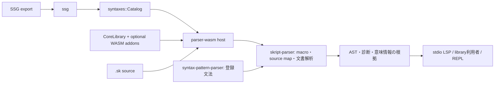

# Skript-LSP

[English](README.md)

[Skript](https://github.com/SkriptLang/Skript)向けのLanguage Serverとparserのworkspaceです。
SkriptSyntaxGenerator（SSG）が対象サーバーの環境から出力した構文データと、WebAssemblyの
parser componentを使います。解析時にMinecraftサーバーやJavaを起動する必要はありません。

現在開発中です。snapshotは利用可能な登録情報を表しますが、それだけでSkriptやすべてのAddonの
動作を実装するものではありません。

## 対応機能

| 機能 | 現在の対応範囲 |
| --- | --- |
| 診断 | Structureのentry、入れ子の実行本文、parser/providerの失敗、根拠がある場合の期待型と実際型。別領域のエラーがあっても、安全に採用できた部分の結果を保持します。 |
| ホバー・補完説明 | 構文、戻り値型、引数宣言、変数の推論型、説明、例、定義情報。登録文法と実行例は異なるcode fenceで示します。 |
| Semantic highlighting | 採用済み構文、関数名、変数、literal、補間区切り。Skript独自のtoken分類にはclient側の対応が必要です。 |
| 補完・引数案内 | Structureのentry、文のtemplate、文法の継続語、Expression、関数、scope内の変数。要求型が確定すれば既知の不適合な戻り値型を除外し、Unknownや未検証の代替は保守的に扱います。 |
| 定義移動・参照検索 | 解決済み関数と静的に識別できる変数。原文とscopeを確認し、project内の未open文書も検索対象にできます。 |
| 安全なリネーム | ソースのある関数と、条件を満たす静的な単一ローカル変数。編集範囲の網羅性、編集先のopen、version付き編集に対応するclientが必要です。 |
| 呼び出し階層 | ソースを確認できる関数本文同士のincoming/outgoing calls。再帰と複数文書に対応します。 |
| 構造一覧 | providerのmetadataと、検証した原文範囲・親子関係に基づくdocument symbols。 |
| Inlay hints | 明示した関数実引数の名前と、対応する初期化済み暗黙引数。原文は変更しません。 |

正確な契約は[LSPの動作と制限](docs/lsp.ja.md)を参照してください。
静的解析であり、実行時評価やリンターではありません。

## ビルドと接続

stable Rust toolchain、Cargo、WebAssembly targetを用意し、repository rootで実行します。

```sh
rustup target add wasm32-unknown-unknown
cargo run -p xtask --locked -- build-core-library
cargo build --locked --release --bin skript-lsp
```

実行ファイルは`target/release/skript-lsp`（Windowsでは`skript-lsp.exe`）、または設定済みの
`CARGO_TARGET_DIR`以下へ出力されます。必須のCoreLibraryはcompile時に埋め込まれるため、
componentを更新したら実行ファイルも再buildします。外部parser addonはhostと同じ契約が必要です。
現在はWIT `nlaocs:skript-parser-addon@0.49.0`、ABI `31.0`です。
現在のCoreはcatalog-data v6の有界な`class-lineage`も使うため、hostとCoreを一緒にbuildしてください。
通常の宣言型・保存変換と実行時保証の区別は[保存型推論](docs/declared-storage-inference.md)を参照してください。

対象サーバーのSkript・Addon構成から、完全なSSG export directoryを用意します。
このrepositoryはexportを読み取る側で、generatorは独立したMinecraft pluginです。
archive readerの`ssg::load`はschema 3～7に対応しますが、LSPは`load_for_parsing`を使い、
現行schema 7とCoreLibraryが必要とするmetadataを要求します。loaderが再生成を要求したexportは更新してください。
任意metadataが解析精度を高める場合もあります。Addon固有の意味論には追加parser WASM componentが必要な場合もあります。

`skript-lsp --stdio`で起動します（引数なしもstdio）。clientは明示した一つのprojectの`rootUri`、
または一件の`workspaceFolders`と、次の設定を渡します。

```json
{
  "snapshotPath": "/path/to/complete-ssg-export",
  "addonPaths": []
}
```

これはCLI引数ではなく`initializationOptions`です。pathは絶対path、またはproject rootからの
相対pathです。無関係な親repositoryではなく、対象のSkriptソースfolderをrootにします。
snapshotを読み直す場合はserverの再起動が必要です。

- [Neovimの設定と操作](docs/neovim.ja.md)：付属例はNeovim 0.12以降の標準APIを使います。
  基本機能に追加pluginは不要です。
- [VS Code / Insiders拡張](editors/vscode/README.md)：stable API（最低1.100）を使うlocal試作版です。
  Insiders専用APIは使いません。serverとSSGデータは別途用意し、実際のclient/themeでの表示確認も必要です。

## アーキテクチャ



hostがtransaction付き解析、動的登録、Text・Tree・AST macroを調整します。CoreLibraryは
ほかのcomponentも利用できる共通Addon契約を通じてSkript固有の意味論を実装します。
LSPは採用済みの解析結果と検証済みmetadataからeditor用の情報を作り、Structureごとに
綴りを調べる別parserを持ちません。

| Crate | 役割 |
| --- | --- |
| [`skript-lsp`](src/lib.rs) | CoreLibraryの埋め込み、parser hostの構築、stdio protocol、editor用の情報。 |
| [`ssg`](ssg/README.ja.md) | サーバーのsnapshot exportの読込と検証。 |
| [`syntaxes`](syntaxes/README.ja.md) | 正規化したCatalog、登録identity、型関係、converter、alias。 |
| [`syntax-pattern-parser`](syntax-pattern-parser/README.ja.md) | `(send|message) %string%`のような登録patternを解析。`.sk`ソース用ではありません。 |
| [`skript-parser`](skript-parser/README.ja.md) | 原文範囲とSourceMap、情報を落とさない字下げtree、再帰照合、Structure entry、関数registry。 |
| [`parser-wasm`](parser-wasm/README.ja.md) | WIT契約、Wasmtime host、lifecycle hook、StateStore、transaction付きpipeline。 |
| [`core-library`](core-library/README.ja.md) | 組込の解析意味論を実装する必須WASM component。 |
| [`skript-repl`](utilities/skript-repl/README.ja.md) | 一行の検証と複数行の文書REPL、version付きJSON出力。 |
| [`xtask`](xtask/README.ja.md) | CoreLibraryと試験componentのbuild・Component化・検証。 |

[`skripthub`](skripthub/README.ja.md)と
[`invalid-syntax-searcher`](utilities/invalid-syntax-searcher/README.ja.md)は互換性・corpus調査用です。
通常のLanguage ServerはSkriptHubからデータを取得しません。

libraryからは`new_parser_host`を利用できます。runtime metadata付きのCatalog、または情報不足を
補う明示的なruntime profileが必要で、`HostConfig::default()`だけではparserの設定は完了しません。
guest componentは`parser-wasm`へ`default-features = false`で依存します。

## 主な制限

- **Projectの範囲：** serverごとに一つのrootとsnapshotを使い、open bufferをdiskより優先します。
  探索上限は512 source、50,000 directory entry、深さ64、1 fileあたり1 MiB、合計16 MiBです。
  symlinkやreparse pointは辿りません。探索未完了を完全な名前空間として扱わず明示します。
  複数文書の解析には全componentの`parser.project-stable-semantics` v1宣言が必要です。
- **リネーム：** ASCII識別子の静的な単一ローカル変数が対象です。global、list family、parameter、
  動的名、曖昧な原文位置、不完全な編集範囲は対象外です。関数ではproject全体の網羅性と衝突も確認します。
  編集先の全文書がopenかつ現在版である必要があり、read-onlyの参照検索より対応範囲が狭くなります。
- **呼び出し階層・構造一覧：** 階層のnodeはソースのある関数で、Event/Commandの入口やCatalogだけの
  関数は含みません。構造一覧にはproviderのmetadataが必要で、未対応・曖昧な範囲は省略されます。
- **型：** 引数の宣言型、parse contextの要求型、保存値の推論型は別の情報です。対応する代入では
  関数の既知の戻り値型も伝播しますが、provider、変換、alias、制御flow、snapshotの根拠不足により
  Unknownになる場合があります。評価順を伴う補間の一部でも、後続localの型を保守的に失います。
  これは標準Number formatterが無関係なlocalを書き換えると実証したものではありません。
  完全な手続き間の値・副作用解析は行いません。
- **待ち時間と表示：** 対応clientでは準備済み補完を最終解析より先に返せますが、大きな文書の初回診断・
  ホバー・意味による色付けには待ち時間が残ります。本文解析は並列化されておらず、検証済みhookの再利用も
  AST全体の再利用ではありません。候補更新時にclientによってちらつく場合があり、一定時間内の応答や
  ちらつきのないmenuを保証しません。

Unknownを型適合の証拠としたり、補完から一律に消したりしません。未検証の文法継続候補は、型付きの
候補と区別して示します。変数型のinlay hintや追加の型確度区分は、実装済み機能ではありません。

## 開発とテスト

hostのintegration testはCoreLibraryに加えて試験componentも埋め込みます。
workspace全体を試験する前に両方を用意します。

```sh
cargo run -p xtask --locked -- build-core-library
cargo run -p xtask --locked -- build-test-components
cargo test --workspace --all-features --locked --jobs 2
```

対象を絞った確認では、不要な全体実行を避けられます。

```sh
cargo test -p syntax-pattern-parser --locked
cargo test -p ssg --locked
cargo test -p syntaxes --locked
cargo test -p skript-parser --locked
cargo test -p parser-wasm --locked
cargo test -p skript-lsp --all-features --locked --lib --test lsp_stdio
```

同じartifactを用意してからAPI文書を生成できます。

```sh
cargo doc --workspace --all-features --no-deps --locked
```

同じplatform/toolchainでは既存のCargo targetを再利用します。生成componentはGit管理外です。
出力一覧とexport検証は[xtask](xtask/README.ja.md)、任意のeditor integration testは各editor文書を
参照してください。headless/API試験は、物理画面のmenuや全themeの見え方を保証するものではありません。

[Rust CI](.github/workflows/ci.yml)は`main`向けpull requestでworkspace全体を試験します。
`main`の一部の設定・依存更新や手動dispatchはcache準備用で、これらは全testの実行とは異なります。

## 関連文書

- [LSP protocol・意味情報・制約](docs/lsp.ja.md)
- [Neovim](docs/neovim.ja.md) / [VS Code・Insiders](editors/vscode/README.md)
- [DefaultExpression APIとAddon](docs/default-expressions.ja.md)
- 各crateのREADMEと、生成したRust API文書
