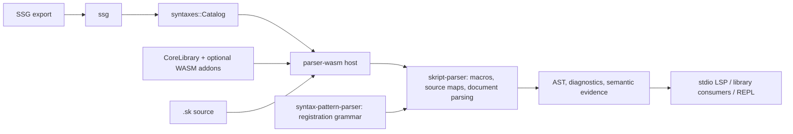

# Skript-LSP

[日本語](README.ja.md)

A language server and parser workspace for [Skript](https://github.com/SkriptLang/Skript).
Skript-LSP uses syntax data exported by SkriptSyntaxGenerator (SSG) for a specific
server environment, together with WebAssembly parser components. Parsing does
not require a running Minecraft server or Java installation.

The project is under development. A snapshot describes available registrations;
it does not by itself implement every Skript or addon behavior.

## Features

| Feature | Current coverage |
| --- | --- |
| Diagnostics | Structure entries, nested executable bodies, parser/provider failures, and expected/actual types where the parser has sufficient evidence. Safe results from independent regions can survive errors elsewhere. |
| Hover and completion details | Syntax, return types, parameter declarations, inferred variable types, descriptions, examples, and definition information. Registration grammar and executable examples have separate code fences. |
| Semantic highlighting | Adopted syntax, function names, variables, literals, and interpolation delimiters. Custom Skript token roles require client support. |
| Completion and signature help | Structure entries, statement templates, grammar continuations, expressions, functions, scoped variables, and captured finite type values (enum/parser/supplier values and snapshot aliases). Known incompatible types are filtered when the expected type is established; Unknown and unverified alternatives remain conservative. |
| Definitions and references | Resolved functions and statically identifiable variables, with source and scope checks. Project queries can include unopened files. |
| Safe rename | Source-backed functions and eligible static scalar locals. Requires complete editable coverage, open edit targets, and a client that supports versioned edits. |
| Call hierarchy | Incoming/outgoing calls between resolved source-backed function bodies, including recursion and project documents. |
| Document symbols | Structure outlines from provider metadata, with validated source ranges and hierarchy. |
| Inlay hints | Names of explicit function arguments and supported initialized implicit arguments. Hints do not modify source text. |

Type-value completion reuses finite SSG parser strings, supplier values, enum
values, and captured aliases; it does not assume that every parser is enumerable.
It supports multiword spellings and bounded prefix search, recomputing proposals
as the prefix narrows. Values are offered only at established literal-capable
argument positions. When required trailing words are still unwritten, direct
typed slots can supply proposals marked as an unfinished syntax suffix. This
proposal evidence is separate from hard expression type filtering. Arbitrary parser inputs (for example RGB components),
script-local aliases and runtime-only values are not enumerated. Suggestions
do not guarantee that a runtime parser or addon-specific guard will accept them.
Completion ranking uses exact matches and the actual searched text before applying
the shared menu cap. Empty or one-character prefixes apply a soft browsing cost
to finite values, so expanded value lists do not automatically displace useful
expressions. Stronger prefixes still favor nearby word completions such as
`sto` → `stone`. Clients may apply their own fuzzy scores and usage history;
the server order alone cannot guarantee the displayed order.

See the [LSP behavior and limitations](docs/lsp.ja.md) for the exact contracts.
This is static analysis, not runtime execution or a linter.

## Build and connect

Use a stable Rust toolchain, Cargo, and the WebAssembly target. From the repository root:

```sh
rustup target add wasm32-unknown-unknown
cargo run -p xtask --locked -- build-core-library
cargo build --locked --release --bin skript-lsp
```

The executable is `target/release/skript-lsp` (`skript-lsp.exe` on Windows), or
under the configured `CARGO_TARGET_DIR`. CoreLibrary is mandatory and embedded
at compile time: rebuild the executable after updating that component. External
parser addons must match the host contract, currently WIT
`nlaocs:skript-parser-addon@0.42.0`, ABI `24.0`.

Obtain a complete SSG export directory from the target server's Skript/addon
environment. This repository reads those exports; the generator is a separate
Minecraft plugin. The `ssg::load` archive reader supports schemas 3–7, but the
LSP uses `load_for_parsing`: it requires current schema 7 and the metadata needed
by CoreLibrary. Regenerate incomplete exports when the loader requests it.
Optional metadata can improve type precision. Some addon semantics also need a
parser WASM component.

Start the server with `skript-lsp --stdio` (stdio is also the default). The client
must send one explicit project `rootUri` or one `workspaceFolders` entry, plus:

```json
{
  "snapshotPath": "/path/to/complete-ssg-export",
  "addonPaths": []
}
```

These are `initializationOptions`, not CLI flags. Paths can be absolute or
relative to that project root. Select the actual Skript source folder rather
than an unrelated ancestor repository. Reloading a snapshot requires restarting
the server.

- [Neovim setup and operations](docs/neovim.ja.md): the bundled example uses
  Neovim 0.12+ standard APIs; basic operation needs no extra plugin.
- [VS Code / Insiders extension](editors/vscode/README.md): a local prototype
  using stable VS Code APIs (minimum 1.100), with no Insiders-only API. The server
  and SSG data are supplied separately. Editor rendering still needs validation
  in the actual client/theme.

## Architecture



The host coordinates transactional parsing, dynamic registrations, and Text,
Tree, and AST macros. CoreLibrary implements Skript-specific semantics through
the same addon contract available to other components. The LSP derives editor
views from adopted parser results and authenticated metadata, not a second
spelling-based parser for each structure.

| Crate | Responsibility |
| --- | --- |
| [`skript-lsp`](src/lib.rs) | Embedded CoreLibrary, parser-host construction, stdio protocol, and editor views. |
| [`ssg`](ssg/README.md) | Load and validate server snapshot exports. |
| [`syntaxes`](syntaxes/README.md) | Normalized catalog, registration identities, type relations, converters, and aliases. |
| [`syntax-pattern-parser`](syntax-pattern-parser/README.md) | Parse registration patterns such as `(send|message) %string%`; not `.sk` source. |
| [`skript-parser`](skript-parser/README.md) | Source ranges/maps, lossless indentation tree, recursive matching, structure entries, and function registry. |
| [`parser-wasm`](parser-wasm/README.md) | WIT contract, Wasmtime hosting, lifecycle hooks, StateStore, and transactional pipelines. |
| [`core-library`](core-library/README.md) | Mandatory WASM component implementing built-in parsing semantics. |
| [`skript-repl`](utilities/skript-repl/README.md) | One-line inspector and multiline document REPL with versioned JSON output. |
| [`xtask`](xtask/README.md) | Build, encode, and validate CoreLibrary and test components. |

[`skripthub`](skripthub/README.md) and
[`invalid-syntax-searcher`](utilities/invalid-syntax-searcher/README.md) remain
compatibility/corpus tools. Normal language-server operation does not fetch
SkriptHub data.

Library consumers can use `new_parser_host`. A host needs a loaded Catalog with
runtime metadata, or an explicit runtime profile where that metadata is absent;
`HostConfig::default()` alone is not a complete parser setup. Guest components
depend on `parser-wasm` with `default-features = false`.

## Limits to understand

- **Project scope:** one root and snapshot per server. Open buffers override
  disk. Discovery is bounded to 512 sources, 50,000 directory entries, depth 64,
  1 MiB per file, and 16 MiB of source in total; it does not follow symlinks or
  reparse points. Incomplete discovery is reported rather than treated as a
  complete namespace. Multi-document analysis requires every component's
  `parser.project-stable-semantics` v1 opt-in.
- **Local definitions:** use proven reaching writes, or an exact, unambiguous
  explicit declaration when current-value evidence is unavailable. An opaque
  operation can therefore leave a local without a jump target; historical or
  later assignments are not substituted for missing reaching evidence.
  References still follow the static scoped identity.
- **Rename:** static scalar locals only, with ASCII identifier names. Globals,
  list families, parameters, dynamic names, ambiguous origins, and incomplete
  editable coverage are excluded. Function rename also checks project-wide
  coverage and collisions. Every edited document must be open and current;
  read-only references have broader coverage than rename.
- **Call hierarchy and outlines:** hierarchy nodes are source-backed functions,
  not event/command entry points or catalog-only functions. Outlines require
  provider-supplied structure metadata; unsupported or ambiguous ranges can be
  omitted.
- **Types:** declared parameter types, parse-context expectations, and inferred
  stored-value types are different facts. Supported assignments can propagate
  known function return types, but unresolved providers, conversions, aliases,
  control flow, or missing snapshot evidence can leave Unknown. Some ordered
  interpolations still lose later local facts conservatively; this is not proof
  that a standard Number formatter mutates unrelated locals. There is no
  complete interprocedural value/effect analysis.
- **Latency and display:** prepared completion can precede final analysis in
  supporting clients. Initial diagnostics, hover, and semantic highlighting can
  still take time on large documents. Body parsing is not parallelized, and
  validated hook reuse is not full AST reuse. Candidate refresh can flicker in
  some clients; flicker-free menus and fixed response times are not guaranteed.

Unknown types are not silently treated as compatible proof or removed from
completion. Unverified grammar continuations are identified separately from
typed candidates. Variable-type inlay hints and additional type-certainty states
are not implemented features.

## Development and tests

Host integration tests embed test components as well as CoreLibrary. Prepare
both artifact sets before testing the complete workspace:

```sh
cargo run -p xtask --locked -- build-core-library
cargo run -p xtask --locked -- build-test-components
cargo test --workspace --all-features --locked --jobs 2
```

Focused checks can avoid an unnecessary full workspace run:

```sh
cargo test -p syntax-pattern-parser --locked
cargo test -p ssg --locked
cargo test -p syntaxes --locked
cargo test -p skript-parser --locked
cargo test -p parser-wasm --locked
cargo test -p skript-lsp --all-features --locked --lib --test lsp_stdio
```

After the same artifact preparation, generate API documentation with:

```sh
cargo doc --workspace --all-features --no-deps --locked
```

Reuse the existing Cargo target for the same platform/toolchain. Generated
components are not committed. See [xtask](xtask/README.md) for outputs and export
validation, and the editor guides for optional integration tests. Headless/API
checks do not establish physical menu rendering or every theme's appearance.

[Rust CI](.github/workflows/ci.yml) runs full workspace tests on pull requests
targeting `main`. Selected configuration/dependency changes on `main` and manual
dispatch prepare caches; those cache-only paths do not run the full test suite.

## More documentation

- [LSP protocol, semantics, and limitations](docs/lsp.ja.md) (Japanese)
- [Neovim](docs/neovim.ja.md) / [VS Code and Insiders](editors/vscode/README.md) (Japanese)
- [DefaultExpression API and addons](docs/default-expressions.md)
- Crate READMEs and generated Rust API documentation for library contracts
